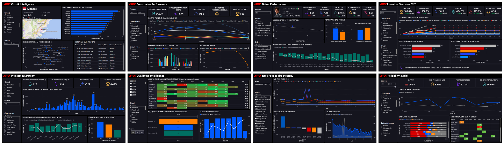
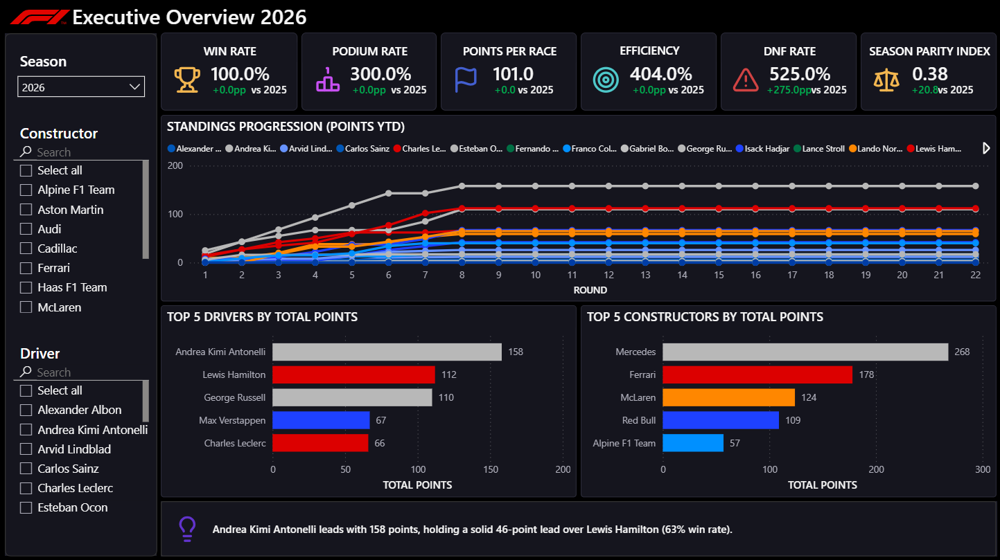
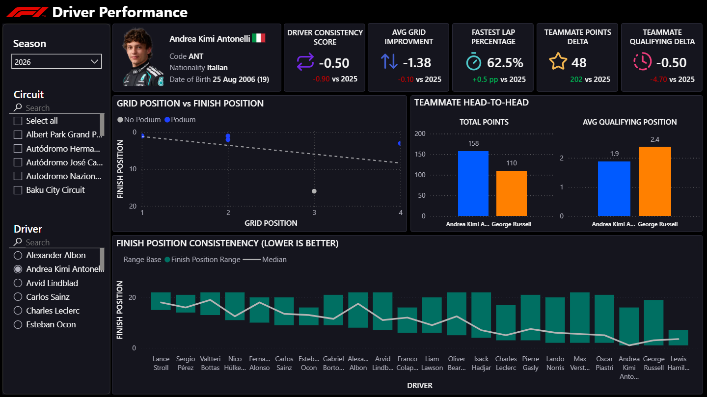
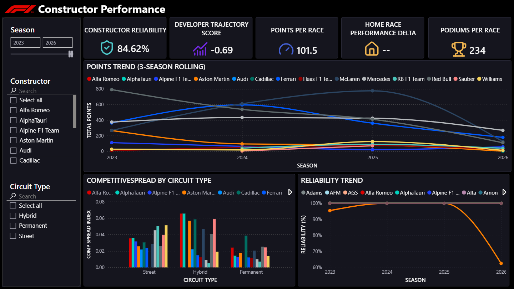
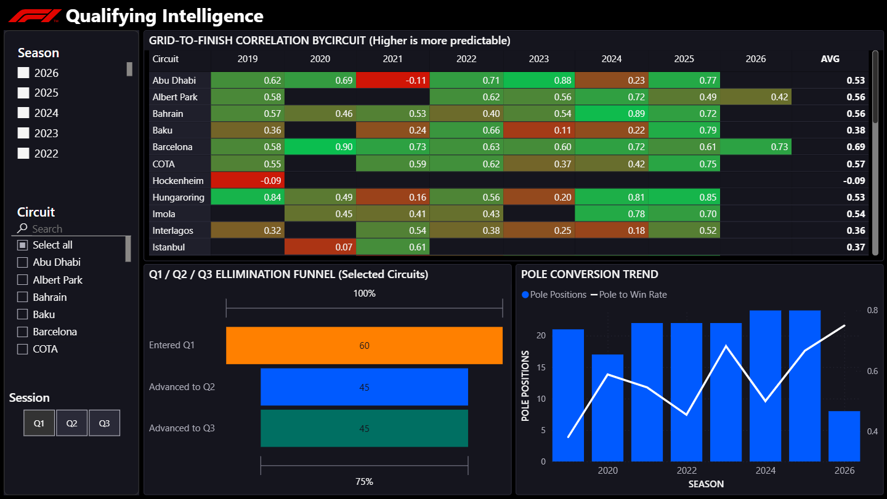
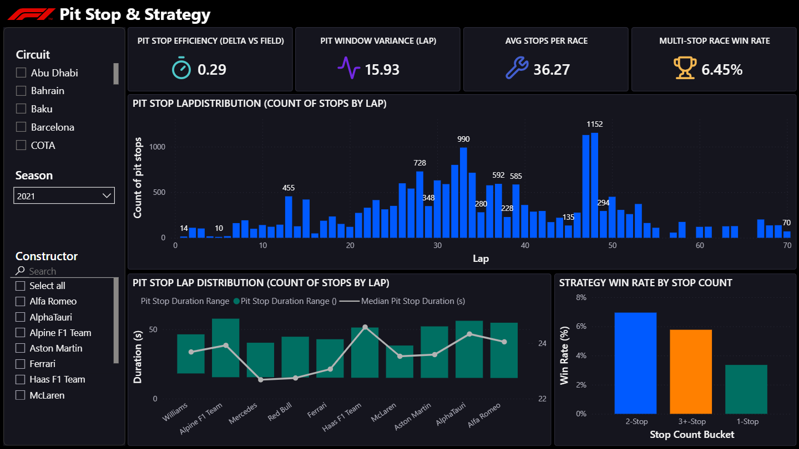
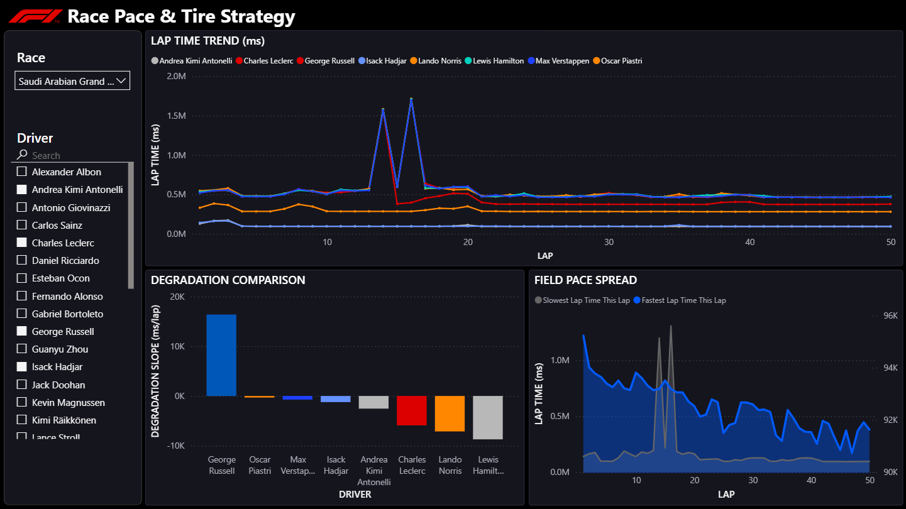
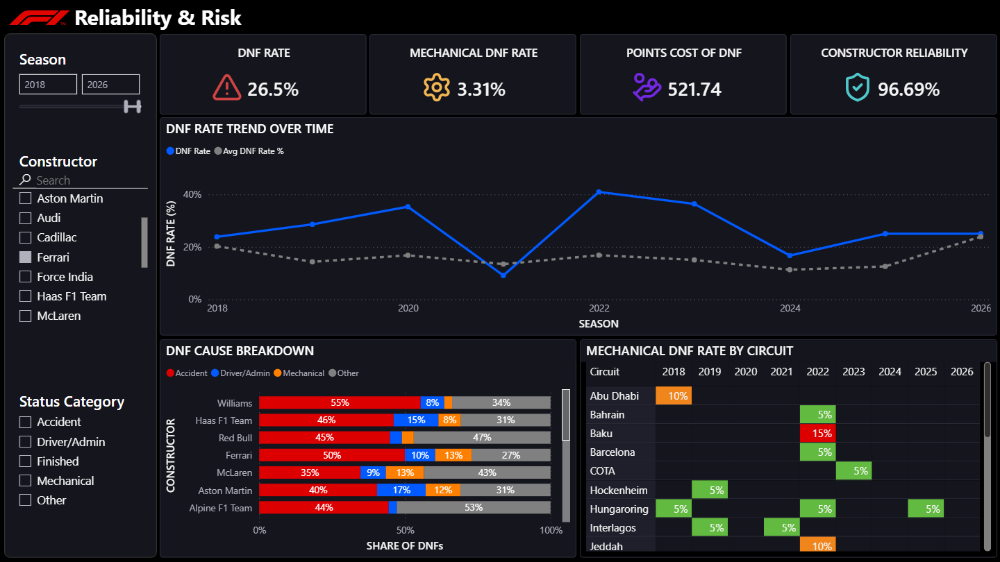
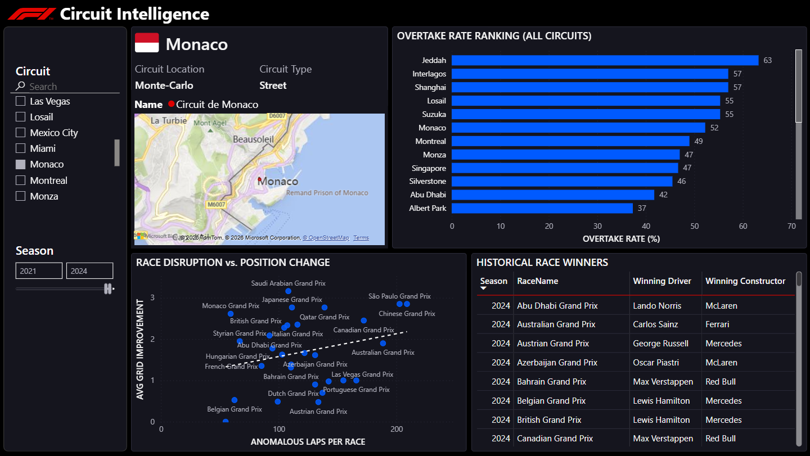

<div align="center">

# 🏎️ Formula 1 Strategy Intelligence Platform

**An enterprise-grade Business Intelligence solution for race strategy, performance, and championship decision-making**

[](#)
[](#)
[](#)
[](#license)

*Built entirely on free, native tools — Power BI Desktop, Python. No Pro/Premium license, no paid AppSource visuals.*

[View Report](#) · [Documentation](docs/) · [DAX Library](dax/DAX_Measures_Library.md)

</div>

---

## Overview

The Formula 1 Strategy Intelligence Platform turns 70+ years of race results, qualifying, pit stop, and lap-level data into decision-ready intelligence for a Formula 1 team's leadership, strategy, and engineering functions.

Every one of the 8 dashboard pages is scoped to a specific decision a **Team Principal**, **Race Engineer**, **Strategy Lead**, **Performance Engineer**, or **Sporting Director** actually has to make — before, during, or after a Grand Prix — and every KPI, DAX measure traces back to one of 50 documented business questions.

**📁 Full documentation:** [`/docs`](docs/)

---

## Table of Contents

- [Business Problem](#business-problem)
- [Architecture](#architecture)
- [Data Model](#data-model)
- [Dashboard Pages](#dashboard-pages)
- [Dashboard Preview](#dashboard-preview)
- [KPI Framework](#kpi-framework)
- [DAX Measure Library](#dax-measure-library)
- [Technology Stack](#technology-stack)
- [Project Structure](#project-structure)
- [Future Roadmap](#future-roadmap)

---

## Business Problem

F1 teams generate enormous volumes of timing, strategy, and reliability data, but most of it lives in disconnected systems (timing feeds, engineering logs, championship standings) that are hard to interrogate quickly under race-weekend time pressure. Three recurring problems motivate this platform:

1. **Strategy calls are made on incomplete historical context.** Undercut/overcut timing, pit windows, and tire degradation patterns aren't systematically compared across circuits and seasons.
2. **Driver and constructor performance is judged on outcome (points), not on process (pace, consistency, grid conversion).** This makes it hard to separate a car problem from a driver problem or a strategy problem.
3. **Reliability and operational risk are reviewed reactively**, after a DNF costs a championship position, rather than tracked as a leading indicator.

### Who Uses It

| Role | Core Decision Supported |
|---|---|
| Team Principal | Season trajectory, resource allocation, driver/constructor investment |
| Sporting Director | Regulatory and championship-points strategy, reliability risk |
| Strategy Department | Pit windows, tire strategy, undercut/overcut timing per circuit |
| Race Engineers | Driver-specific pace and consistency trends, setup feedback |
| Performance Engineers | Car performance vs. grid, sector-level competitiveness |

### Business Value

- Faster, evidence-based strategy calls, reducing reliance on gut-feel pit calls
- Objective driver performance benchmarking that removes bias from teammate comparisons
- Early-warning reliability tracking that catches championship risk before it costs points
- A reusable analytics framework that generalizes across seasons as new data lands

---

## Architecture

```
Raw CSVs (Kaggle: Formula 1 Race Data)
        │
        ▼
   Python ETL & Feature Engineering
   (etl.ipynb → feature_engineering.ipynb → advanced_analytics.ipynb)
        │
        ▼
   Power Query (M) — star schema shaping, surrogate keys, type enforcement
        │
        ▼
   Star Schema Semantic Model — 6 fact tables, 8 dimension tables (Power BI)
        │
        ▼
   DAX Measure Layer — 80+ measures
        │
        ▼
   8-Page Power BI Report — 100% native visuals, no Pro/Premium required
   (Executive · Driver · Constructor · Qualifying · Pit Stop & Strategy ·
    Race Pace & Tires · Reliability & Risk · Circuit Intelligence)
```

### Pipeline

1. **Extract** — raw Kaggle CSVs (`results`, `races`, `drivers`, `constructors`, `qualifying`, `pit_stops`, `lap_times`, `status`, `circuits`).
2. **Transform (Python)** — cleaning, name normalization, feature engineering: grid deltas, stint boundaries, teammate comparisons, driver/constructor livery color mapping, tire degradation slopes.
3. **Transform (Power Query)** — final shaping into the star schema, surrogate keys, a generated calendar dimension, incremental-refresh-friendly structure.
4. **Load** — Power BI semantic model with a fully documented 81-measure DAX library.
5. **Serve** — 8-page report with a custom dark theme and real per-team, per-driver livery colors.

See [`/noteboos`](notebooks/) for the notebooks

---

## Data Model

Star schema — **6 fact tables**, **8 dimension tables**. Full grain, relationships, and modeling rationale: [`docs/Data_Dictionary.md`](docs/Data_Dictionary.md).

| Fact Tables | Dimension Tables |
|---|---|
| `FactRaceResults` | `DimDriver`, `DimConstructor`, `DimCircuit` |
| `FactLapTimes`, `FactPitStops`, `FactQualifying` | `DimRace`, `DimSeason`, `DimDate`, `DimStatus`, `DimDriverSeasonColor` |
| `FactStints`, `FactDriverSeasonStats` | |

`FactQualifying` is modeled separately from `FactRaceResults` on purpose: raw one-lap qualifying pace and the post-penalty starting grid position answer genuinely different business questions, and collapsing them into one column would hide that distinction. `DimSeason` exists as a dedicated calendar-grain dimension so season-level features (teammate deltas, driver color assignment) relate cleanly without forcing season logic through the race-grain table. No fact table relates directly to another — cross-fact questions (e.g., "did the pole-sitter go on to win?") are answered via `TREATAS`-based DAX bridging through shared dimensions, keeping every relationship in the model at a single, unambiguous grain.

---

## Dashboard Pages

| # | Page | Primary Audience | Answers |
|---|---|---|---|
| 1 | Executive Overview | Team Principal, Sporting Director | Season trajectory, standings, momentum |
| 2 | Driver Performance | Race Engineers, Team Principal | Consistency, grid conversion, teammate comparison |
| 3 | Constructor Performance | Team Principal, Performance Engineers | Reliability, development trajectory, competitive spread |
| 4 | Qualifying Intelligence | Strategy Department, Race Engineers | Grid-to-finish predictability, Q1/Q2/Q3 conversion |
| 5 | Pit Stop & Strategy | Strategy Department, Race Engineers | Pit windows, undercut value, execution quality |
| 6 | Race Pace & Tire Strategy | Performance Engineers, Strategy Department | Stint pace, degradation, field spread |
| 7 | Reliability & Risk | Sporting Director, Team Principal | DNF rate, mechanical risk, points cost of failure |
| 8 | Circuit Intelligence | Strategy, Race & Performance Engineers | What each circuit rewards, overtaking, historical winners |

---

## Dashboard Preview

<div align="center">

</div>

<details>
<summary><strong>Individual page layouts</strong></summary>

| Executive Overview | Driver Performance |
|---|---|
|  |  |

| Constructor Performance | Qualifying Intelligence |
|---|---|
|  |  |

| Pit Stop & Strategy | Race Pace & Tire Strategy |
|---|---|
|  |  |

| Reliability & Risk | Circuit Intelligence |
|---|---|
|  |  |

</details>


---

## KPI Framework

**30 executive KPIs** spanning results, consistency, strategy execution, and reliability, grouped by the audience each one serves. Full definitions and formulas: [`docs/KPI_Definitions.md`](docs/KPI_Definitions.md).

| KPI | What It Isolates |
|---|---|
| Driver Consistency Score | Reliability of *finishing where pace suggests*, independent of car performance |
| Teammate Delta (Qualifying) | Pure one-lap pace, isolated from grid penalties and race-day variance |
| Constructor Reliability | Car-caused DNFs only — separates a car problem from a driver problem |
| Pit Window Variance | How exploitable a circuit's pit strategy timing actually is |
| Season Parity Index | League-wide competitive balance trend, not just one team's form |

---

## DAX Measure Library

**81 measures across 13 display folders** — [`dax/DAX_Measures_Library.md`](dax/DAX_Measures_Library.md). A few patterns worth a technical reviewer's attention:

- **Cross-fact bridging via `TREATAS`.** No two fact tables share a direct relationship. Measures like `Pole to Win Rate` and `Multi-Stop Race Win Rate` build a virtual key table from one fact table and push it onto another, keeping every relationship in the model at a single, correct grain.
- **Season-guarded comparison measures.** Teammate and career-comparison KPIs explicitly require a single-season selection before returning a value, so they can't be silently misread when aggregated across multiple seasons.
- **Native-only visual techniques.** A floating-bar chart (transparent base + visible range segment via a Stacked Column + Line combo) delivers box-plot-style distribution views using only Power BI's built-in visuals — full implementation included.
- **Explicit modeling assumptions.** Measures with inherent simplifications (e.g., `Max Possible Points`, `Expected Points If Finished`) are documented with their assumptions stated plainly, rather than presented as more precise than they are.

---

## Technology Stack

- **Power BI Desktop** — semantic model, DAX, report layer, 100% native visuals (no Pro/Premium, no paid AppSource visuals)
- **Python** (`pandas`, `numpy`, `scikit-learn`, `matplotlib`, `pyarrow`) — ETL, feature engineering, clustering, degradation modeling, strategy simulation
- **Power Query (M)** — transformation and star-schema shaping layer
- **GitHub** — version control and portfolio presentation

---

## Project Structure

```
Formula-1-Strategy-Intelligence/
│
├── docs/
│   ├── Business_Requirements.md
│   ├── Data_Dictionary.md
│   ├── KPI_Definitions.md
│   ├── Power_Query_Transformations.md
│
├── notebooks/
│   ├── etl.ipynb
│   ├── feature_engineering.ipynb
│   ├── advanced_analytics.ipynb
│   └── Analytics_Plan.md
│
├── dax/
│   ├── DAX_Measures_Library.md
│
├── Formula1_Strategy_Intelligence.pbix
├── F1_Strategy_Intelligence_Theme.json
│
├── images/
│   ├── executive_overview.png
│   ├── driver_performance.png
│   ├── constructor_performance.png
│   ├── qualifying_intelligence.png
│   └── pit_stop_and_strategy.png
│   └── race_pace_and_strategy.png
│   └── reliability_and_risk.png
│   └── circuit_intelligence.png
│   └── dashboard_overview.png
│
├── README.md
└── requirements.txt
```

**Folder rationale:** `docs/` is what a reviewer reads before opening the `.pbix` — the business case, data contract, and design rationale behind the build. `dax/` is isolated on its own since it's typically the first thing a technical reviewer checks. `notebooks/` demonstrate fluency independent of Power BI. `powerbi/` is the deliverable itself.

---

## Future Roadmap

- Live/near-live timing feed simulation in place of the static CSV load
- Python-based race strategy simulator (undercut/overcut expected-value model) surfaced via a Power BI Python visual
- Predictive reliability scoring using scikit-learn
- Safety-car period detection via lap-time anomaly clustering, feeding a dedicated strategy-risk KPI
- Row-level security to simulate multi-team access patterns

---

## License

This project is licensed under the MIT License — see [`LICENSE`](LICENSE) for details.

*Uses the public [Formula 1 Race Data dataset](https://www.kaggle.com/datasets/jtrotman/formula-1-race-data) on Kaggle. Independent portfolio project — not affiliated with Formula 1, FIA, or any constructor team.*
